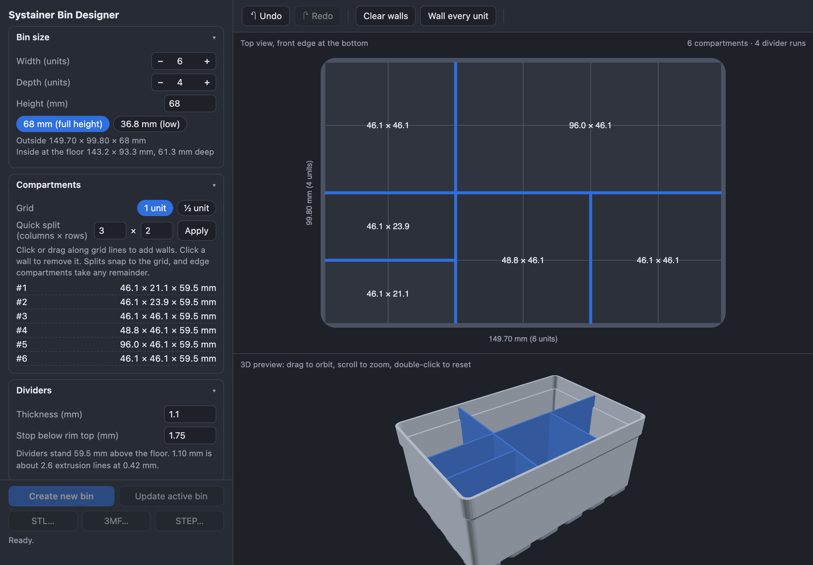
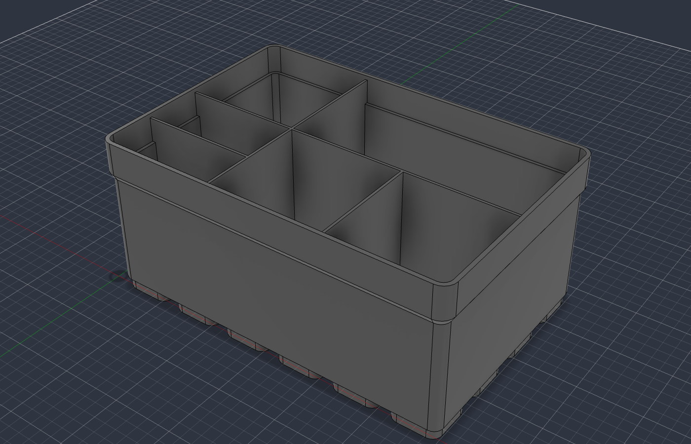

# Systainer Bin Designer

A free Autodesk Fusion add-in for designing 3D-printable organizer bins (insert boxes) for **Tanos / Festool Systainer³ organizers**.

You size the bin on the organizer's grid and draw compartments in a top-view editor, with a live 3D preview. Then you build a fully parametric bin in Fusion and export it as STL, 3MF or STEP.





## Features

- **Grid-based sizing**: width and depth in organizer units, any height from the minimum the rim allows up to 300 mm.
- **Compartment editor**:
  - Click or drag along grid lines to add walls, and click a wall to remove it.
  - Quick split into even columns × rows, a ½-unit grid for finer splits, and undo/redo.
  - A live list of compartment sizes.
- **Live 3D preview** that you can orbit and zoom.
- **Real parametric model**:
  - Fully constrained sketches, and user parameters with the same names as the original template (`NumUnitsX`, `NumUnitsY`, `OneUnit`, `BoxHeight`, `RimHeight`, …), so *Modify › Change Parameters* still works.
  - Dividers are one exact solid that the designer regenerates.
- **Update in place**: change the layout and rebuild the active bin as a single undo step, or turn on auto-update.
- **Built-in verification**: every build reads the result back and checks for:
  - one solid body of the expected size,
  - every divider present,
  - every compartment empty,
  - every foot present and hollow.
- **Fit presets**: *Tuned* (default, adjusted through test prints) or the original *Template* values. Every tolerance can be edited, or loaded from any open bin that uses the template's parameter names.
- **Export** to STL, 3MF or STEP with versioned file names (`systainer-bin-6x4-h68-v1.stl`, …). Existing files are never overwritten.
- **Saved layouts** for bins you print often.
- Validation catches impossible settings (rim too tall for the height, foot ring too thin, and so on) before anything is built.

## Requirements

- Autodesk Fusion (a current release; personal, commercial and education licenses all work).
- macOS or Windows. Development and testing were done on macOS. Windows uses the same code paths, but please report any problems.

## Installation

1. Download this repository (green **Code** button › *Download ZIP*, or `git clone`).
2. Put the `SystainerBinDesigner` folder (the one containing `SystainerBinDesigner.manifest`) into Fusion's add-ins folder:
   - **macOS:** `~/Library/Application Support/Autodesk/Autodesk Fusion 360/API/AddIns/`
   - **Windows:** `%APPDATA%\Autodesk\Autodesk Fusion 360\API\AddIns\`

   Alternatively, in Fusion open **UTILITIES › Add-Ins › Scripts and Add-Ins**, click **+** next to *My Add-Ins*, and select the folder wherever it lives.
3. In **Scripts and Add-Ins**, select *SystainerBinDesigner* and click **Run**. Tick *Run on Startup* to keep it loaded.
4. Open it from **SOLID › CREATE › Systainer Bin Designer**.

## Usage

1. **Bin size**: set the width and depth in units (one unit is about 25 mm) and the height.
2. **Compartments**: click or drag on grid lines, or use *Quick split*. Each compartment's inside size appears in the editor and in the list.
3. **Dividers**: set the thickness (a multiple of your extrusion width works best) and how far below the rim top they stop.
4. **Create new bin** builds the bin in a new, unsaved Fusion document. Save it wherever you like.
5. Edit the layout, then **Update active bin** to rebuild it in place. **Load from active bin** reads a saved bin's layout back into the editor.
6. **STL… / 3MF… / STEP…** exports the bin.

### Printing tips

- Print open side up. The feet print directly on the bed, and the rim chamfer keeps the overhang printable without supports.
- 3 perimeters (about 1.2–1.3 mm with a 0.4 mm nozzle) suit the 1.75 mm walls well. A 1.1–1.3 mm divider prints as 2–3 lines.
- If bins sit too tight or too loose, adjust **Fit & tolerances**. Grid pitch and nub opening matter most. Print a 1 × 1 or 2 × 2 test bin first.

## How the model is built

| Feature | What it does |
|---|---|
| `SBD Body` + corners + shell | Lower body: footprint inset by `UnitSquarePadding`, corner radius `BoxCornerRadius`, shelled to `BoxWallThickness` |
| `SBD Rim` + corners + shell + join | Wider top rim at the full footprint, `RimHeight` tall |
| `SBD Rim Chamfer` | Chamfer under the rim overhang (`UnitSquarePadding` at `RimChamferAngle`) |
| `SBD Foot` + corners + shell + pattern | Hollow foot rings that sit around the organizer's floor nubs, patterned over the grid |
| `SBD Dividers` | Base feature with the union of all dividers, regenerated by the designer |
| `SBD Final Join` | Joins feet and dividers into the single `SystainerBin` body |

The layout is stored in the document (attribute `SystainerBinDesigner/config`). Saved layouts and settings live in a per-user folder: `~/Library/Application Support/SystainerBinDesigner` on macOS, `%APPDATA%\SystainerBinDesigner` on Windows.

**Editing a bin by hand:** add your own features *after* `SBD Final Join`. *Update active bin* regenerates only the last two features. Features that reference the divider geometry may need repairing after an update.

## Limitations

- Compartments follow the grid (1 or ½ unit). Free-form divider positions aren't supported yet.
- Dividers are straight, square-ended walls. Label tabs, finger scoops and lids aren't included (yet).
- The 3D preview is a lightweight approximation. The Fusion model is the reference.

## Development

```
SystainerBinDesigner/
  SystainerBinDesigner.py   add-in entry point, palette bridge, undoable update command
  sbd_layout.py             layout rules and validation (pure Python, no Fusion)
  sbd_builder.py            Fusion geometry, read-back verification, export
  palette/                  HTML/CSS/JS user interface (layout.js mirrors sbd_layout.py)
tests/
  test_layout.py            unit tests for the layout rules
  test_parity.py            checks that layout.js and sbd_layout.py agree (needs Node.js)
  fusion_smoke_test.py      integration test, run inside Fusion
```

Run the tests outside Fusion with:

```
python3 -m unittest discover -s tests -v
```

For the integration test, add `tests/fusion_smoke_test.py` in **Scripts and Add-Ins** and run it. It builds bins in temporary documents, compares them with reference geometry, and closes only the documents it created.

You can open `palette/index.html` directly in a browser to work on the UI. It runs in preview mode without Fusion.

## Credits

The bin geometry follows **“Tanos/Festool Systainer Organizer Insert (parameterized)” by Heyus** (<https://www.printables.com/model/208217>), licensed under [CC BY 4.0](https://creativecommons.org/licenses/by/4.0/). See [NOTICE.md](NOTICE.md).

## License

The code is released under the [MIT License](LICENSE).

*Festool, Tanos and Systainer are trademarks of their respective owners. This project isn't affiliated with or endorsed by them.*
